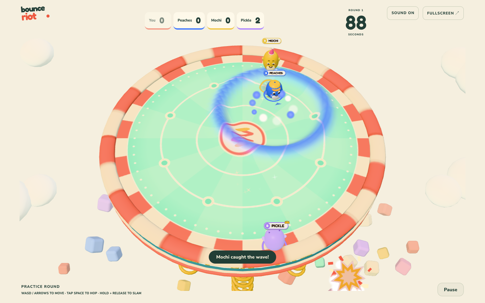
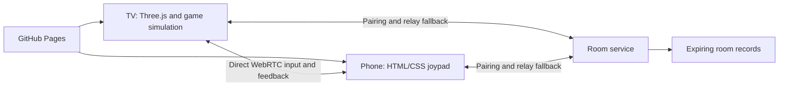

# Bounce Riot

**Make waves.** A 3D trampoline party brawler for one shared screen and up to eight players. Your phones are the controllers.

Open the game on a TV browser or computer, host a room, and let friends scan the QR code. Everyone sees the same arena. Hold to charge a slam, release to send a wave through the floor, and hop onto a rival's wave to turn it against them.



## Play

**[Play Bounce Riot](https://manishh-13.github.io/bounce-riot/)**

1. Open the game on the big screen and choose **Host a party**.
2. Put phones on the same Wi-Fi for the best chance of a direct connection.
3. Scan the TV QR code, enter a nickname, then enter the controller.
4. The first player is captain and can start the round from their phone.
5. Left thumb moves. Tap the action button to hop. Hold and release to slam.

No phone app or account is needed. Use **Try it with bots** for keyboard practice: WASD/arrows to move and Space to hop or charge. The game includes scoring, short respawns, configurable rounds, three arena variants, pause and rematches.

### Fullscreen phones

- Android Chrome: use **Enter fullscreen & play**.
- iPhone: Safari's Share menu > **Add to Home Screen** gives a browser-chrome-free launch. Re-enter the room code in the installed launch if necessary.
- Screen wake lock is requested where supported. Calls, notifications, battery policy and system navigation cannot be blocked by a web game.
- The controller cancels held inputs on backgrounding or touch cancellation. It offers a resume action when you return.

### Connectivity

The game runs locally on the big-screen device. Phones send inputs through a direct WebRTC data channel when possible. A room service exchanges connection details and provides an authenticated WebSocket relay fallback.

**Same Wi-Fi does not mean completely offline.** The public room service still needs internet to create and join rooms. Routers with client isolation, VPNs and browser restrictions can prevent direct peer connections. The controller shows whether it is direct or using relay.

GitHub Pages hosts only the static frontend. The repository includes the separate room service, so this is not relying on Pages to run a WebSocket server.

## Run locally

Requires Node.js 22 or newer.

```sh
npm ci
npm run signal
```

In a second terminal:

```sh
npm run dev
```

Open `http://localhost:4381`. Local signaling listens on port 4382. The same game can be tested across devices by configuring `VITE_SIGNAL_URL` for a reachable room service; secure public hosting is recommended for fullscreen, wake lock and WebRTC compatibility.

## Verify

```sh
npm test
npm run build
npx playwright install chromium
npm run test:e2e
```

On macOS the browser tests use an existing Google Chrome installation by default. Set `CHROME_PATH` to choose a different executable. In CI, Playwright's Chromium is installed. Tests cover deterministic simulation and room-service rules, plus browser gameplay, actual direct controller pairing, relay fallback, captain start, reconnect and rematch.

## Deploy

The GitHub Actions workflow tests the code, builds the static site, then publishes to GitHub Pages. Set the repository's Pages source to **GitHub Actions**.

The room service is deployed separately. See `infra/README.md` for its deployment script, security controls and cost notes. The public `public/config.json` contains only the WebSocket service URL, never AWS keys or tokens. For a fork, deploy your own room service and update that URL and the server's allowed origins.

## Architecture



The TV is authoritative. Players cannot submit scores or positions. The room service assigns identities and validates room membership; reconnect credentials are random and stored hashed on the service. Room access is possession of a temporary room code. This is a friends-in-a-room game, not an anti-cheat system for ranked competitive play.

## Scope and limits

This is a playable first release, not a claim that every smart TV is supported. Use a current Chrome-based browser with WebGL2. Older TV hardware may need Low graphics. Laptop-to-TV HDMI is a fallback. Physical TV and mobile-device testing remains necessary even when automated browser tests pass.

There is no public matchmaking, monetization, user account system or microphone/camera collection. See [Privacy](docs/PRIVACY.md), [game design](docs/DESIGN.md), and [third-party notices](THIRD_PARTY.md).

## License

MIT. Original procedural artwork and synthesized sound are included under the same license. Bundled fonts retain their SIL Open Font License. Third-party dependencies retain their respective licenses.
